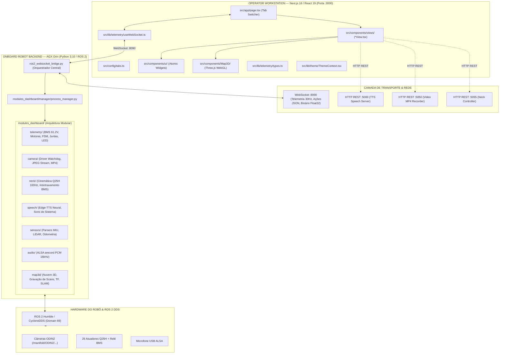

# ESTRUTURA E GUIA DE ARQUITETURA PARA IA — DASHGROUP ARCANJO (T800)

> **Documento Oficial de Engenharia e Instruções para Modelos de IA e Desenvolvedores**  
> **Versão do Sistema:** v1.7.3+ | **Plataforma:** Robô Humanóide T800 (NVIDIA Jetson AGX Orin)  
> **Objetivo:** Estabelecer a arquitetura canônica, diagnosticar dívidas técnicas e definir o procedimento padrão obrigatório (SOP) para implementação, extensão e refatoração de funcionalidades no Dashboard.

---

## 1. Manifesto e Diretriz Central para a IA

Ao trabalhar neste repositório, qualquer Agente de IA ou desenvolvedor deve seguir estritamente o seguinte princípio:

> **"Uma funcionalidade NUNCA é colocada de forma avulsa na raiz, nem acoplada diretamente em arquivos monolíticos. Cada nova capacidade pertence a um módulo backend em `modules_dashboard/` e a uma view/componente bem delimitado no frontend `src/`."**

Se você for instruído a "adicionar uma nova função", "integrar um novo sensor", "criar um controle novo" ou "adicionar uma tela", você **NÃO DEVE**:
1. ❌ Criar scripts soltos na raiz do projeto.
2. ❌ Criar views isoladas sem vinculá-las ao fluxo de abas em `src/config/tabs.ts` e `src/app/page.tsx`.
3. ❌ Inchar o hook `src/lib/telemetry/useWebSocket.ts` com centenas de linhas de lógica de negócio específica.
4. ❌ Inserir blocos gigantescos de `if/elif` de comandos no laço de recepção de `ros2_websocket_bridge.py`.
5. ❌ Deixar componentes e instrumentos órfãos (sem uso) acumulando poeira no repositório.
6. ❌ Finalizar a tarefa sem atualizar `src/config/version.ts`, `README.md` e rodar os testes unitários (`python3 -m unittest discover tests` e `npx tsc --noEmit`).

---

## 2. Visão Geral da Arquitetura do Sistema

O sistema é uma **Estação de Operação, Telemetria e Controle Tático** para o robô humanóide **T800**, conectando uma interface Next.js 16 moderna ao ecossistema ROS 2 Humble via WebSockets de alta velocidade (30 Hz) e microserviços auxiliares REST.



---

## 3. Mapeamento Completo da Estrutura de Diretórios

Abaixo está o mapa de responsabilidade de cada diretório e arquivo do projeto:

```text
dashboard/
├── .agents/                          # Configurações e regras para agentes de IA
│   └── rules/
│       ├── instrucoes.md             # Regras gerais de engenharia e versionamento
│       └── arquitetura.md            # Regras estritas de arquitetura (aponta para este guia)
├── modules_dashboard/                # BACKEND MODULAR PYTHON (Executa onboard no robô)
│   ├── common/
│   │   └── base_module.py            # Classe abstrata BaseModule (contrato obrigatório)
│   ├── manager/
│   │   └── process_manager.py        # Gerenciador de ciclo de vida, portas e watchdogs
│   ├── telemetry/
│   │   └── telemetry_service.py      # Agregador de telemetria ROS 2, BMS, FSM, LEDs, Bag
│   ├── camera/
│   │   ├── camera_service.py         # Inscrição de câmeras, compressão JPEG e watchdog
│   │   └── video_recorder.py         # Gravação contínua em MP4 local (porta :5050)
│   ├── neck/
│   │   ├── neck_manager.py           # Gestor de interface do pescoço Q25H
│   │   └── neck_controller.py        # Controlador cinemático 100Hz com proteção de BMS
│   ├── speech/
│   │   ├── speech_manager.py         # Gerenciador de voz e sinais sonoros
│   │   └── speech_server.py          # Servidor Edge-TTS neural (porta :5000)
│   ├── sensors/
│   │   ├── sensor_service.py         # Serviço de leitura e parsing de tópicos de sensores
│   │   └── parsers.py                # Decodificadores de dados brutos de sensores
│   ├── audio/
│   │   └── audio_service.py          # Captura física do microfone USB via ALSA arecord
│   └── map3d/                        # Sub-sistema de mapeamento 3D volumétrico
│       ├── mapping/                  # Processamento de nuvem de pontos e matrizes
│       ├── recording/                # Gravador e gestor de scans (.ply / .pcd)
│       ├── ros/                      # Assinantes ROS 2 dedicados (TF, Odom, Laser, IMU)
│       ├── stream/                   # Protocolo binário Float32 zero-copy
│       └── websocket/                # Multiplexador e despachante de eventos 3D
├── src/                              # FRONTEND NEXT.JS 16 / REACT 19
│   ├── app/
│   │   ├── globals.css               # Estilos Tailwind v4, scrollbars e utilitários
│   │   ├── layout.tsx                # Layout raiz HTML com ThemeProvider
│   │   └── page.tsx                  # Home do dashboard: roteador das 6 abas principais
│   ├── config/
│   │   ├── tabs.ts                   # CONFIGURAÇÃO OFICIAL DAS ABAS (ID, Nome, Ícone, Ordem)
│   │   └── version.ts                # Metadados de versão SemVer e data de build
│   ├── components/
│   │   ├── layout/                   # Componentes de infraestrutura visual do dashboard
│   │   │   ├── TopBar.tsx            # Barra superior (conexão, BMS, FSM, RC, IP, tema)
│   │   │   ├── Navigation.tsx        # Barra de navegação por abas
│   │   │   └── Footer.tsx            # Rodapé com diagnóstico de rede e versão
│   │   ├── views/                    # VIEWS PRINCIPAIS (Cada aba tem 1 View correspondente)
│   │   │   ├── OverviewView.tsx      # Aba 1: Cockpit geral
│   │   │   ├── PerceptionView.tsx    # Aba 2: Câmeras e visão estéreo
│   │   │   ├── PeopleVisionTestView.tsx # Aba 3: Detecção de pessoas com IA client-side
│   │   │   ├── HardwareControlView.tsx  # Aba 4: Controle de juntas, pescoço e matriz térmica
│   │   │   ├── PointCloudView.tsx    # Aba 5: Mapeamento 3D estilo Foxglove
│   │   │   ├── WatchdogView.tsx      # Aba 6: Diagnóstico de nós, tópicos e rede
│   │   │   └── Orientation3DView.tsx # [DEPRECATED / ÓRFÃO - Ver Seção 4]
│   │   ├── Map3D/                    # Componentes Three.js WebGL da visualização 3D
│   │   │   ├── Map3DViewer.tsx       # Canvas 3D principal com iluminação e controles de órbita
│   │   │   ├── PointCloud.tsx        # Renderizador volumétrico de pontos com coloração
│   │   │   ├── RobotPose.tsx         # Modelo 3D / representação da pose do robô
│   │   │   ├── RobotTrajectory.tsx   # Traçado de histórico de odometria
│   │   │   ├── MapGrid.tsx           # Grade de referência métrica no solo
│   │   │   ├── CoordinateAxes.tsx    # Eixos cartesianos XYZ (RGB)
│   │   │   ├── MapControls.tsx       # Barra de ferramentas da câmera e filtros de nuvem
│   │   │   ├── MapStatus.tsx         # HUD de status de FPS, contagem de pontos e latência
│   │   │   ├── CameraViewport.tsx    # Projeção de câmera sobre a cena 3D
│   │   │   ├── OrientationGizmo.tsx  # Gizmo interativo de orientação espacial
│   │   │   └── ScanDrawer.tsx        # Gaveta lateral de histórico de gravações de scans
│   │   ├── ui/                       # COMPONENTES ATÔMICOS REUTILIZÁVEIS
│   │   │   ├── Card.tsx              # Container padrão com cabeçalho e glassmorphism
│   │   │   ├── KpiCard.tsx           # Card numérico com indicador de tendência e status
│   │   │   ├── StatusBadge.tsx       # Etiqueta de status com cores semânticas e pulso
│   │   │   ├── AlertBanner.tsx       # Banner de alerta para erros e avisos críticos
│   │   │   ├── ThemeToggle.tsx       # Botão de alternância Dark/Light mode
│   │   │   ├── BatteryGauge.tsx      # Indicador gráfico do estado da bateria 61.2V
│   │   │   ├── MotorThermalMatrix.tsx# Matriz térmica dos 25 motores e diagnóstico NTC
│   │   │   ├── RobotHardwareStatus.tsx# Resumo dos subsistemas e barramentos
│   │   │   ├── NeckJoystickControl.tsx# Controle interativo 2D para pitch/yaw da cabeça
│   │   │   ├── CompactNeckControl.tsx# Versão enxuta do controle de pescoço
│   │   │   ├── CompactLedControl.tsx # Seletor de cores da fita de LED frontal
│   │   │   ├── RobotSpeechControl.tsx# Caixa de texto e acionador de TTS com vozes
│   │   │   ├── AudioStreamControl.tsx# Player e medidor VU do microfone do robô
│   │   │   ├── CameraStream.tsx      # Visualizador de vídeo JPEG com controles
│   │   │   ├── VisionPopover.tsx     # Janela flutuante Picture-in-Picture (PiP)
│   │   │   ├── SystemLogs.tsx        # Terminal visual para logs e mensagens
│   │   │   └── JsonViewer.tsx        # Inspecionador de árvore JSON para telemetria
│   │   └── instruments/              # INSTRUMENTOS ANALÓGICOS / VOO
│   │       ├── ArtificialHorizon.tsx # [ÓRFÃO - Ver Seção 4]
│   │       ├── MiniHorizon.tsx       # [ÓRFÃO - Ver Seção 4]
│   │       └── PointCloudCanvas.tsx  # [ÓRFÃO - Canvas 2D substituído por Three.js]
│   └── lib/                          # SERVIÇOS, HOOKS E UTILITÁRIOS
│       ├── telemetry/
│       │   ├── types.ts              # TIPAGEM TS OFICIAL DE TODA A TELEMETRIA
│       │   └── useWebSocket.ts       # Hook de conexão WebSocket e estado compartilhado
│       ├── theme/
│       │   └── ThemeContext.tsx      # Contexto React de tema (Dark/Light)
│       ├── math/
│       │   └── imuMath.ts            # Conversão Quaternions -> Euler e acelerômetro
│       ├── audio/
│       │   ├── soundEffects.ts       # Cues sonoros do navegador (Web Audio API)
│       │   └── useRobotAudio.ts      # Hook de reprodução de áudio streaming PCM
│       └── vision/
│           ├── visionEngine.ts       # Pipeline de inferência TensorFlow.js COCO-SSD
│           ├── useCameraRecorder.ts  # Gravador de vídeo client-side
│           └── types.ts              # Tipos de detecção e anotações visuais
├── tests/                            # SUÍTE DE TESTES PYTHON (unittest)
│   ├── test_advanced_telemetry.py    # Testes de BMS, FSM, termistores e telemetria
│   ├── test_binary_protocol.py       # Testes de serialização Float32 zero-copy
│   ├── test_camera_service.py        # Testes de inicialização e rotas da câmera
│   ├── test_map3d.py                 # Testes de streaming 3D e processamento
│   ├── test_neck_interlock.py        # Testes de bloqueio de segurança BMS do pescoço
│   ├── test_orchestrator.py          # Testes de ciclo de vida do orquestrador central
│   ├── test_process_manager.py       # Testes de liberação de portas e watchdogs
│   ├── test_scan_recorder.py         # Testes de gravação e exportação de scans
│   ├── test_sensors.py               # Testes de decodificação de sensores
│   ├── test_sound_cues.py            # Testes de notificações sonoras
│   └── test_telemetry.py             # Testes do serviço base de telemetria
├── INSTRUCOES.md                     # Diretrizes gerais de engenharia e versionamento
├── README.md                         # Documentação pública do projeto
├── robot_preflight_check.py          # Script automatizado de diagnóstico de pré-voo
└── ros2_websocket_bridge.py          # Orquestrador Central e Servidor WebSocket
```

---

## 4. Diagnóstico dos Pontos Desorganizados Atuais (A Bagunça Identificada)

Durante as últimas atualizações, certas funcionalidades foram adicionadas apressadamente, gerando acúmulo de débito técnico. **A IA deve ter ciência explícita destes itens para não perpetuá-los e para ajudar a saneá-los**:

### 4.1. Arquivos Órfãos / Código Morto
* `src/components/views/Orientation3DView.tsx`: Este arquivo foi criado como uma view de horizonte artificial, mas não está cadastrado em `src/config/tabs.ts` nem referenciado em `src/app/page.tsx`.
* `src/components/instruments/ArtificialHorizon.tsx` e `MiniHorizon.tsx`: Criados para telemetria de atitude em Canvas/SVG, mas caíram em desuso e não são importados por nenhum componente ativo.
* `src/components/instruments/PointCloudCanvas.tsx`: Um antigo renderizador 2D de nuvem de pontos, completamente superado pelo módulo `src/components/Map3D/` com Three.js.
* `src/components/TopBar.tsx`: Um arquivo de 3 linhas na raiz de `components` que apenas re-exporta `src/components/layout/TopBar.tsx`.
> **Diretriz para a IA**: Ao criar novos componentes visuais, vincule-os imediatamente ao local onde serão consumidos. Não crie componentes especulativos soltos.

### 4.2. O "God Hook" (`src/lib/telemetry/useWebSocket.ts`)
* O hook `useWebSocketTelemetry` atingiu quase **1.000 linhas de código** e retorna **34 propriedades e funções** em uma única tupla/objeto.
* Ele mistura responsabilidades díspares: ciclo de vida do WebSocket, cálculo de latência, envio de fala (TTS), envio de posições do pescoço, controle de LED, disparo de gravação de bag ROS 2, estado da nuvem 3D, armazenamento de scans e reprodução de áudio.
* Isso gera **prop-drilling excessivo** no `src/app/page.tsx`, que precisa receber dezenas de propriedades e repassá-las manualmente para cada uma das views.
> **Diretriz para a IA**: Ao adicionar uma nova funcionalidade, **NÃO insira mais 10 estados dentro de `useWebSocket.ts`**. Crie um hook modular dedicado (ex: `src/lib/telemetry/useLidarScans.ts` ou um Contexto especializado) que consome o transporte base do WebSocket.

### 4.3. Violações de Hooks do React 19 / ESLint
O linter do projeto aponta erros em efeitos:
* `ThemeContext.tsx` e `useCameraRecorder.ts` chamam `setState` síncrono no corpo do `useEffect`, gerando alertas de cascata de renderização no React 19.
* `useWebSocket.ts` possui dependências incompletas nos arrays de dependência de `useEffect`.
> **Diretriz para a IA**: Sempre respeite as diretrizes do React 19. Não execute `setState` síncrono dentro do corpo imediato de um `useEffect` sem condicional ou inscrição de evento.

### 4.4. Ações WebSocket Acumuladas no Orquestrador
No `ros2_websocket_bridge.py`, a função `handler` possui uma sequência de `if/elif` de mais de 150 linhas processando comandos de texto. Alguns módulos (como `map_stream`) já possuem método próprio `handle_action()`, mas outros ainda têm lógica de parsing embutida diretamente no laço do orquestrador.
> **Diretriz para a IA**: Ao adicionar um novo comando WebSocket no backend, delegue o tratamento dos dados para o método do módulo especializado (ex: `modulo.handle_command(data)`), mantendo o orquestrador enxuto.

---

## 5. Procedimento Padrão (SOP): Como Organizar Novas Funcionalidades

Toda vez que a IA for requisitada a adicionar uma nova funcionalidade, deve seguir rigorosamente as 5 etapas abaixo:

### ETAPA 1 — Backend: Criação ou Extensão de Módulo (`modules_dashboard/`)

Se a funcionalidade envolve ROS 2, hardware, comunicação ou processamento onboard:
1. **Onde criar:** Crie um diretório em `modules_dashboard/<nome_da_funcionalidade>/`.
2. **Contrato Obrigatório:** Crie uma classe que herde de `BaseModule` (`modules_dashboard/common/base_module.py`):
   ```python
   from modules_dashboard.common.base_module import BaseModule

   class MinhaNovaFuncionalidadeService(BaseModule):
       def __init__(self, logger=None):
           super().__init__("minha_funcionalidade", logger)
           # inicialize propriedades locais
           
       def initialize(self, context=None) -> bool:
           # Configure tópicos ROS 2, publishers ou arquivos
           self.is_initialized = True
           self.status = "INITIALIZED"
           return True

       def start(self) -> bool:
           self.is_running = True
           self.status = "RUNNING"
           return True

       def stop(self) -> bool:
           self.is_running = False
           self.status = "STOPPED"
           return True

       def handle_action(self, action: str, data: dict) -> dict:
           """Trata comandos recebidos do WebSocket do Dashboard."""
           if action == "minha_acao":
               # processar
               return {"status": "success"}
           return {"status": "unknown_action"}
   ```
3. **Registro no Gerenciador:** No `ros2_websocket_bridge.py` (método `main()`):
   - Instancie o serviço.
   - Registre via `pm.register_module(meu_servico)`.
   - No `handler` do WebSocket, adicione apenas o despacho limpo:
     ```python
     elif action and action.startswith("meu_prefixo/"):
         resp = orchestrator.meu_servico.handle_action(action, data)
         if resp:
             await websocket.send(json.dumps(resp))
     ```

### ETAPA 2 — Tipagem e Contratos de Dados (`src/lib/telemetry/types.ts`)

Antes de escrever qualquer componente visual:
1. Abra `src/lib/telemetry/types.ts`.
2. Adicione as interfaces TypeScript representando o novo payload de dados e comandos:
   ```typescript
   export interface MinhaFuncionalidadeData {
     status: 'IDLE' | 'ACTIVE' | 'ERROR';
     valor_metrico: number;
     timestamp: number;
   }
   ```
3. Se fizer parte da telemetria contínua a 30 Hz, inclua o campo opcional na interface `T800Telemetry`:
   ```typescript
   export interface T800Telemetry {
     // ... campos existentes ...
     minha_funcionalidade?: MinhaFuncionalidadeData | null;
   }
   ```

### ETAPA 3 — Configuração de Abas ou Widgets no Frontend

#### Cenário A: A funcionalidade é uma Nova Aba/Tela Completa
1. **Configurar a Aba em `src/config/tabs.ts`:**
   - Adicione o tipo literal em `TabType`:
     ```typescript
     export type TabType = 'overview' | 'perception' | 'cv_test' | 'hardware' | 'pointcloud' | 'watchdog' | 'minha_aba';
     ```
   - Adicione a entrada na lista `DASHBOARD_TABS` definindo `id`, `label`, `shortLabel`, `icon` (escolha um ícone semântico de `lucide-react`) e `order`:
     ```typescript
     {
       id: 'minha_aba',
       label: '7. Minha Nova Ferramenta',
       shortLabel: 'Ferramenta',
       icon: Wrench,
       order: 7
     }
     ```
2. **Criar a View em `src/components/views/<Nome>View.tsx`:**
   - Toda View deve ser `'use client'`.
   - Deve receber ao menos `telemetry: T800Telemetry | null` e `connectionStatus: ConnectionStatus`.
   - Exemplo de casca de View:
     ```tsx
     'use client';
     import React from 'react';
     import { Card } from '../ui/Card';
     import { T800Telemetry, ConnectionStatus } from '@/lib/telemetry/types';
     import { Wrench } from 'lucide-react';

     export interface MinhaAbaViewProps {
       telemetry: T800Telemetry | null;
       connectionStatus: ConnectionStatus;
       onExecutarAcao?: (param: string) => boolean;
     }

     export function MinhaAbaView({ telemetry, connectionStatus, onExecutarAcao }: MinhaAbaViewProps) {
       return (
         <div className="space-y-6">
           <Card
             title="MINHA NOVA FERRAMENTA"
             subtitle="Painel de controle e monitoramento especializado"
             headerIcon={<Wrench className="w-5 h-5 text-blue-500" />}
           >
             {/* Conteúdo modular */}
           </Card>
         </div>
       );
     }
     ```
3. **Plugar a View em `src/app/page.tsx`:**
   - Importe a nova View.
   - Adicione a renderização condicional correspondente:
     ```tsx
     {activeTab === 'minha_aba' && (
       <MinhaAbaView
         telemetry={telemetry}
         connectionStatus={connectionStatus}
         onExecutarAcao={/* callback */}
       />
     )}
     ```

#### Cenário B: A funcionalidade é um Widget/Controle Reutilizável
1. Se for um componente genérico de UI (botão, gauge, card, modal), coloque em: `src/components/ui/<NomeComponente>.tsx`.
2. Se for um instrumento de navegação 3D, coloque em: `src/components/Map3D/<NomeComponente>.tsx`.
3. Importe e use o componente dentro das views apropriadas.

### ETAPA 4 — Padrões de Design e UX Obrigatórios

Para manter o visual profissional, tático e futurista do Dashgroup Arcanjo:
1. **Paleta e Glassmorphism:**
   - Fundos translúcidos com borda sutil:
     ```html
     bg-white/80 dark:bg-slate-900/60 backdrop-blur-md border border-slate-200 dark:border-slate-800 rounded-xl
     ```
   - Cores primárias de destaque: Tons de azul militar / ciano (`text-blue-500`, `bg-blue-600`, `border-blue-500/30`).
2. **Cores Semânticas de Status:**
   - 🟢 **Operação Normal / OK:** Emerald/Verde (`text-emerald-400`, `bg-emerald-500/10`, `border-emerald-500/30`).
   - 🟡 **Atenção / Degradação:** Âmbar/Amarelo (`text-amber-400`, `bg-amber-500/10`, `border-amber-500/30`).
   - 🔴 **Crítico / Alarme / Bloqueio:** Rose/Vermelho (`text-rose-400`, `bg-rose-500/10`, `border-rose-500/30`).
   - 🔵 **Comunicação / Dados Ativos:** Ciano/Azul (`text-cyan-400`, `bg-cyan-500/10`, `border-cyan-500/30`).
   - ⚪ **Inativo / Desconectado:** Slate (`text-slate-400`, `bg-slate-800/40`).
3. **Ícones:** Use exclusivamente ícones da biblioteca `lucide-react`. Padronize dimensões com `w-4 h-4` (inline) ou `w-5 h-5` (títulos de cards).
4. **Suporte a Dark Mode:** Todas as classes Tailwind devem declarar suporte duplo (ex: `text-slate-900 dark:text-slate-100`).

### ETAPA 5 — Testes e Validação Obrigatória

Antes de declarar qualquer funcionalidade como pronta:
1. **Criar Teste Python:** Adicione um teste em `tests/test_<nome_funcionalidade>.py` usando `unittest`.
2. **Executar a Suíte de Testes:**
   ```bash
   python3 -m unittest discover tests
   ```
   *Todos os testes devem passar com `OK`.*
3. **Validar Tipos do TypeScript:**
   ```bash
   npx tsc --noEmit
   ```
   *Nenhum erro de compilação ou tipo pode ser emitido.*
4. **Testar Pré-Voo Onboard:**
   ```bash
   python3 robot_preflight_check.py
   ```

---

## 6. Tabela Rápida de Decisão para a IA (Cheat Sheet)

| Quero adicionar... | Onde criar o arquivo? | Qual padrão seguir? |
| :--- | :--- | :--- |
| **Novo assinante de tópico ROS 2** | `modules_dashboard/<tema>/` | Criar serviço herdando de `BaseModule` e registrar no `ProcessManager`. |
| **Novo comando enviado do painel ao robô** | `modules_dashboard/<tema>/` + `ros2_websocket_bridge.py` | Implementar `handle_action` no módulo e despachar no bridge. |
| **Nova propriedade de telemetria contínua** | `src/lib/telemetry/types.ts` | Extender `T800Telemetry` e serializar no `telemetry_service.py`. |
| **Nova aba de navegação** | `src/config/tabs.ts` + `src/components/views/<Nome>View.tsx` | Registrar em `DASHBOARD_TABS` e renderizar no `page.tsx`. |
| **Novo botão, card ou widget genérico** | `src/components/ui/<Widget>.tsx` | Componente funcional com Tailwind, dark mode e tipagem explícita. |
| **Novo elemento na cena 3D (ex: bounding box, mesh)** | `src/components/Map3D/<Elemento>.tsx` | Componente Three.js / `@react-three/fiber` integrado no `Map3DViewer.tsx`. |
| **Novo efeito sonoro ou voz** | `src/lib/audio/soundEffects.ts` | Web Audio API sintetizada ou síntese neural via `modules_dashboard/speech/`. |
| **Novo algoritmo de visão no navegador** | `src/lib/vision/` | Pipeline modular com TensorFlow.js ou WebAssembly. |

---

## 7. Checklist de Conclusão e Entrega (Conforme INSTRUCOES.md)

Toda tarefa só pode ser dada como finalizada quando este checklist for cumprido:

- [ ] Código modularizado no local correto (sem poluir a raiz).
- [ ] Tipagens TypeScript rigorosas em `types.ts` (sem uso desgovernado de `any`).
- [ ] Se houver nova aba, configurada em `tabs.ts` e renderizada em `page.tsx`.
- [ ] Testes automatizados executados (`python3 -m unittest discover tests` -> `OK`).
- [ ] Compilação TypeScript checada (`npx tsc --noEmit` -> sem erros).
- [ ] `src/config/version.ts` atualizado com o incremento SemVer adequado (`MAJOR.MINOR.PATCH`).
- [ ] `README.md` atualizado com o histórico de versão na seção correspondente.
- [ ] Limitações conhecidas documentadas com transparência para o usuário.
