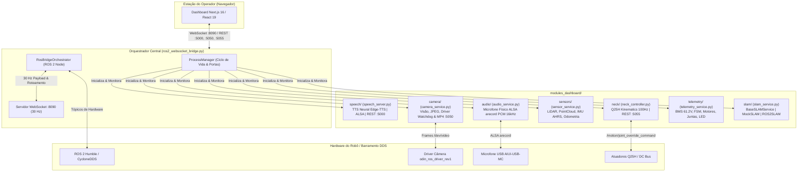

# Dashgroup Arcanjo — Dashboard de Controle e Telemetria T800

Dashboard web e estação de controle para monitoramento em tempo real, telemetria e operação do robô humanóide **T800**.

O sistema integra a interface visual do operador aos serviços em execução no robô via ROS 2 e WebSockets, permitindo supervisão de atuadores, transmissão de câmeras, controle de movimentos da cabeça, síntese de voz e diagnóstico de hardware.

---

## 1. Visão Geral da Arquitetura Modular

A partir da versão **v1.5.0**, a arquitetura do backend do robô foi completamente modularizada. O monolítico `ros2_websocket_bridge.py` foi decomposto em módulos especializados localizados na pasta **`modules_dashboard/`**, atuando agora como um **Orquestrador Central** enxuto e resiliente.

### Diagrama da Arquitetura



---

## 2. Funcionalidades do Sistema

O **Dashgroup Arcanjo** disponibiliza uma estação de controle e telemetria completa, projetada para operação em tempo real, monitoramento crítico e diagnóstico do robô humanóide **T800**:

### 2.1. Telemetria e Monitoramento em Tempo Real (30 Hz)
- **Barramento de Dados de Alta Frequência**: Streaming WebSocket contínuo a 30 Hz com latência sub-milisegundo e multiplexação de dados.
- **Horizonte Artificial e Atitude Inercial**: Renderização tridimensional em tempo real dos ângulos de Euler (Roll, Pitch e Yaw) calculados a partir dos quaternions da IMU do tronco.
- **Gestão Energética e BMS (`/hardware/power_info`)**: Acompanhamento do barramento DC principal (61.2 V), corrente global, percentual de carga, limites de corrente e estado do relé de corte de potência.
- **Máquina de Estados de Locomoção FSM (`/motion/motion_state`)**: Visualização da tarefa ativa (`STANDBY`, `WALK`, `BALANCE`, etc.) e controle de transições de marcha permitidas.
- **Matriz Térmica dos 25 Atuadores (`MotorThermalMatrix`)**:
  - Monitoramento elétrico e térmico individual das 25 juntas articuladas agrupadas anatomicamente (Pernas L/R, Cintura, Braços L/R e Pescoço).
  - Leituras contínuas de temperatura de bobinas e MOSFETs, tensão e corrente de fase.
  - Alarme visual com banner de emergência para $T \ge 75^\circ\text{C}$.
  - **Diagnóstico Preditivo NTC**: Detecção automática de saturação de termistor em circuito aberto (`-40.0 °C` / `ERR 12294`), alertando imediatamente o rompimento de cabos ou falha de conexão interna no motor.
- **Sincronismo Dual de IMUs**: Separação dos fluxos da IMU do Tronco (`/hardware/imu_info` a 100 Hz) e da IMU da Cabeça (`/manifold/ODIN2/device0/imu` a 50 Hz), permitindo análise postural comparativa durante a marcha.
- **Monitoramento do Rádio-Controle Físico (`/hardware/gamepad_keys`)**: Indicação na barra superior (`TopBar`) do status de pareamento do joystick portátil oficial (`RC: ATIVO` / `RC: OFF`) e leitura dos botões e eixos analógicos.
- **Sinalização Tática LED (`set_led_control`)**: Controle dos padrões de iluminação e cor da fita de LED frontal do robô diretamente pelo painel.

### 2.2. Visão Computacional e Câmeras
- **Transmissão Estéreo e Escala de Cinza**: Transmissão em tempo real de `cam0` (esquerda), `cam1` (direita) e `gray` (escala de cinza de alta sensibilidade) com compressão adaptativa JPEG.
- **Modo Picture-in-Picture (PiP) Customizável**: Janela flutuante redimensionável e reposicionável para alternar câmeras secundárias sem desviar a atenção da câmera principal.
- **Fusão Câmera + LiDAR (Projeção 2D Overlay)**: Exibição da nuvem de pontos laser projetada diretamente sobre o feed óptico da câmera (`/manifold/ODIN2/device0/reprojection/overlay`).
- **Gravação Nativa de Vídeo MP4**: Início e término de gravação contínua no disco interno da AGX Orin via API REST HTTP `:5050` sem consumir a banda do link de telemetria do operador.

### 2.3. Mapeamento 3D e Nuvens de Pontos (Three.js / WebGL)
- **Visualizador 3D Interativo de Nuvem de Pontos**: Renderização em WebGL acelerada por hardware para inspeção espacial volumétrica em tempo real.
- **Protocolo Binário Zero-Copy (ArrayBuffer)**: Streaming binário de alto desempenho com floats de 32 bits compactados, eliminando sobrecarga de serialização JSON.
- **Paletas de Coloração Adaptativa**:
  - *Gradiente de Elevação*: Coloração baseada no eixo Z (altura).
  - *Cyberpunk*: Alto contraste ideal para identificação de obstáculos.
  - *Monocromático / Sólido*: Visualização limpa com cores ajustáveis.
- **Nuvem 3D Colorida RGB**: Suporte nativo à renderização da nuvem colorida de fusão do ODIN2 (`/cloud/render`).
- **Controle Dinâmico de Transmissão LiDAR**: Chaveador para ligar/desligar o streaming de dados LiDAR (`map_3d/enable_lidar`), otimizando o uso de rede quando a aba 3D não estiver em foco.

### 2.4. Mapeamento e Navegação SLAM 2D (Nav2 / slam_toolbox)
- **Processamento 100% Onboard**: O motor `async_slam_toolbox_node` executa localmente na AGX Orin, evitando tráfego de dados brutos na rede.
- **Visualizador 2D com Canvas Acelerado**: Renderização fluida a 60 FPS com pan interativo, zoom contínuo e modo *Auto-Follow* para seguir a trajetória do robô.
- **Exportação Genuína de Mapas**: Geração nativa e download direto dos arquivos de mapa padrão Nav2 (`.yaml` + `.pgm` em escala de cinza de 8 bits) gerados no robô.
- **Modo DEMO com Simulação 2D**: Testes completos de interface sem o robô físico via simulador cinemático Python integrado.

### 2.5. Controle da Cabeça e Pescoço (Atuadores Q25H)
- **Cinemática a 100 Hz**: Controle em malha fechada nos eixos de Pitch (-30° a +30°) e Yaw (-70° a +70°) com limites de software rígidos.
- **Partida Segura (*Zero-Error Start*)**: O movimento sempre parte da leitura física real dos encoders (`encoder_pos`), eliminando descompassos ou trancos mecânicos.
- **Interpolação Polinomial Quíntica ($C^2$)**: Transição centralizadora suave com posição, velocidade e aceleração contínuas sem *jerk*.
- **Intertravamento Crítico de Segurança**: Bloqueio rígido de ativação do modo de compensação postural (`balance_mode`) com BMS desligado ou FSM em repouso.

### 2.6. Síntese de Voz (TTS) e Sinais Acústicos
- **Voz Neural de Baixa Latência**: Síntese vocal Microsoft Edge-TTS em português (`pt-BR-AntonioNeural`) com cache de áudio em memória RAM (`/dev/shm`) respondendo em <10 ms.
- **Sinais Acústicos Senoidais (*Chimes*)**: Notificações harmônicas suaves e agradáveis para eventos de conexão e desconexão via ALSA e Web Audio API.
- **Comandos de Fala em Tempo Real**: Envio de texto livre pela interface web ou via tópico ROS 2 `/robot/speech`.

### 2.7. Diagnóstico do Sistema, Watchdog e Caixa-Preta
- **Painel de Saúde de Tópicos ROS 2 em Tempo Real**: Monitoramento individual de taxas em Hz, contagem total de pacotes e latência de cada tópico do barramento.
- **Detecção Inteligente de Desarme de Motion**: Identificação em tempo real de tópicos de controle que transmitiram na inicialização e pararam por E-Stop, com alertas e comandos SSH sugeridos.
- **Filtros por Categoria de Barramento**: Abas rápidas `TODOS`, `MOTION`, `SENSORES` e `TIMEOUT` para isolar falhas de comunicação instantaneamente.
- **Métricas de Rede e QoS**: RTT do WebSocket, taxa de pacotes recebidos, largura de banda em KB/s e diagnóstico de reconexões.
- **Gravação de Caixa-Preta (ROS 2 Bag)**: Disparo e monitoramento de gravação de bags diretamente no SSD do robô (`/data_recorder/bag_record`).
- **Acessibilidade Universal (a11y)**: Conformidade com padrões WCAG, landmarks semânticos, `role="alert"` e suporte a leitores de tela.

---

## 3. Estrutura de Diretórios

```text
dashboard/
├── modules_dashboard/              # Módulos especializados e desacoplados do robô
│   ├── common/
│   │   ├── __init__.py
│   │   └── base_module.py          # Contrato BaseModule (initialize, start, stop, health_check)
│   ├── manager/
│   │   ├── __init__.py
│   │   └── process_manager.py      # Gerenciador de processos, liberação de portas e watchdogs
│   ├── speech/
│   │   ├── __init__.py
│   │   ├── speech_server.py        # Servidor Flask :5000, Edge-TTS, cache RAM e ALSA
│   │   └── speech_manager.py       # Supervisor, tópicos ROS 2 /robot/speak e /robot/speech
│   ├── neck/
│   │   ├── __init__.py
│   │   ├── neck_controller.py      # Controlador cinemático Q25H, 100 Hz e REST :5055
│   │   └── neck_manager.py         # Supervisor, polling 10Hz e travas críticas de segurança
│   ├── camera/
│   │   ├── __init__.py
│   │   ├── camera_service.py       # Compressão JPEG, cam0/cam1/gray e watchdog do driver odin
│   │   └── video_recorder.py       # Gravador MP4 nativo em disco e servidor REST :5050
│   ├── sensors/
│   │   ├── __init__.py
│   │   ├── sensor_service.py       # Processamento de IMU AHRS, Odometria dx/dt e LiDAR
│   │   └── parsers.py              # Parsers otimizados (NumPy) para PointCloud2 e LaserScan
│   ├── audio/
│   │   ├── __init__.py
│   │   └── audio_service.py        # Captura contínua de microfone físico (arecord PCM 16kHz)
│   ├── telemetry/
│   │   ├── __init__.py
│   │   └── telemetry_service.py    # BMS, FSM de locomoção, motores, juntas, gamepad e LEDs
│   └── slam/
│       ├── __init__.py
│       ├── slam_config.py          # Configurações TF, tópicos, parâmetros Nav2 e limites de broadcast
│       ├── slam_state.py           # Máquina de estados (OFFLINE, STARTING, MAPPING, PAUSED, STOPPING, ERROR)
│       ├── slam_topics.py          # Auto-descoberta dinâmica de sensores (LaserScan, Cloud, Odom, IMU, Map)
│       ├── slam_process.py         # Ciclo de vida seguro do async_slam_toolbox_node (Popen, isolamento de sessão)
│       ├── slam_diagnostics.py     # Buffer TF2 (map -> base_link), cálculo de Hz e diagnóstico pré-voo
│       ├── slam_map.py             # Serialização throttled, salvamento no robô (.yaml/.pgm) e payload de download
│       ├── slam_manager.py         # Orquestrador unificado de SLAM (DEMO e ROS 2)
│       ├── mock_slam_service.py    # Simulador cinemático 2D backend para desenvolvimento offline
│       ├── ros2_slam_service.py    # Conexão legada/retrocompatível
│       └── slam_service.py         # Fachada de compatibilidade (alias para SLAMManager)
│

## 4. Descrição Detalhada dos Módulos (`modules_dashboard/`)

Cada módulo opera sob o contrato de ciclo de vida definido em [`BaseModule`](file:///modules_dashboard/common/base_module.py), encapsulando sua lógica, threads, endpoints e conexões ROS 2:

### 4.1. Módulo de Voz e Sinais Sonoros (`modules_dashboard/speech/`)
* **Arquivos**: `speech_server.py`, `speech_manager.py`
* **Porta HTTP**: `5000` | **Tópicos ROS 2**: `/robot/speak`, `/robot/speech`
* **Funcionalidades**:
  * Síntese de voz neural ultra-rápida via Microsoft Edge-TTS usando a voz masculina de alta naturalidade `pt-BR-AntonioNeural` a velocidade ajustada (`+20%`).
  * Cache em memória RAM (`/dev/shm/t800_tts_cache_antonio`) indexado por hash MD5 do texto, permitindo reprodução com latência inferior a 10 ms para frases recorrentes.
  * **Sinais Sonoros de Conexão e Desconexão (*Chimes*)**: Substituição de falas automáticas prolixas por sinais sonoros limpos e elegantes sintetizados em WAV PCM:
    * *Connect*: Tom duplo ascendente D5 (587 Hz) ➔ A5 (880 Hz) indicando conexão bem-sucedida do dashboard.
    * *Disconnect*: Tom duplo descendente A5 (880 Hz) ➔ C5 (523 Hz) indicando desconexão do operador.
  * Saída direta para o hardware de áudio via ALSA (`aplay` / `paplay`) com controle atômico de concorrência (`player_lock`) e interrupção imediata (`/stop`).
  * Endpoints REST: `POST /speak` (envio de texto e fala), `POST /sound/<name>` (emissão de sinal sonoro), `POST /stop` (interrupção imediata), `GET /health` (diagnóstico de serviço e cache).
  * O `SpeechManager` atua como supervisor, relançando o serviço em caso de queda, gerando sinais sonoros e provendo a ponte com o orquestrador WebSocket.

### 4.2. Módulo de Controle do Pescoço (`modules_dashboard/neck/`)
* **Arquivos**: `neck_controller.py`, `neck_manager.py`
* **Porta HTTP**: `5055` | **Tópicos ROS 2**: `/motion/joint_override_command` (publicação), `/hardware/joint_state` e `/joint_states` (subscrição)
* **Funcionalidades**:
  * Controle cinemático em malha fechada a **100 Hz** para os dois atuadores Q25H do pescoço: **J23 (Pitch)** [-30° a +30°] e **J24 (Yaw)** [-70° a +70°].
  * Geração de trajetórias suaves via interpolação polinomial quíntica (5ª ordem), assegurando continuidade de posição, velocidade e aceleração sem saltos bruscos ou *jerk*.
  * Ganho de rigidez $K_p = 100.0$ e amortecimento $K_d = 3.0$ afinados para dinâmica do pescoço humanóide.
  * **Intertravamento Crítico de Segurança FSM & Relé BMS**: Bloqueia de forma rígida a ativação do modo de compensação postural (`balance_mode`) quando o robô está com o relé BMS desativado ou com a máquina de estados em repouso (`IDLE`, `PASSIVE`, `DAMPING`, `STANDBY`).
  * Endpoints REST: `POST /move` (ângulos absolutos em radianos), `POST /step` (incrementos relativos em pitch/yaw), `POST /center` (retorno suave à posição neutra), `POST /balance` (ativação segura de equilíbrio), `GET /status`, `GET /limits`, `GET /health`.
  * *(Documentação técnica completa e formulação matemática em [`docs/CONTROLE_CABECA_ROBO.md`](docs/CONTROLE_CABECA_ROBO.md))*

### 4.3. Módulo de Câmera e Gravação de Vídeo (`modules_dashboard/camera/`)
* **Arquivos**: `camera_service.py`, `video_recorder.py`
* **Porta HTTP**: `5050` | **Tópicos ROS 2**: `/manifold/ODIN2/cam0`, `/manifold/ODIN2/cam1`, `/manifold/ODIN2/gray`
* **Funcionalidades**:
  * Transmissão contínua de vídeo com compressão adaptativa JPEG em tempo real para os canais estéreo e tons de cinza.
  * Watchdog de integridade que monitora o processo do driver de câmera nativo do robô (`odin_ros_driver_rev1`) e reinicia o fluxo se os descritores `/dev/video*` forem resetados.
  * Gravação nativa em formato MP4 (OpenCV `VideoWriter`) diretamente no sistema de arquivos do robô, sem sobrecarregar a largura de banda do link de telemetria.
  * Servidor REST HTTP na porta `5050` gerenciando gravação: `POST /start` (início de gravação com nome e timestamp), `POST /stop` (fechamento seguro do arquivo MP4), `GET /status` (estado atual, duração e tamanho do arquivo), `GET /recordings` (listagem dos vídeos salvos).

### 4.4. Módulo de Sensores e Percepção 3D (`modules_dashboard/sensors/`)
* **Arquivos**: `sensor_service.py`, `parsers.py`
* **Tópicos ROS 2**: `/manifold/ODIN2/point_cloud`, `/manifold/ODIN2/scan`, `/manifold/ODIN2/imu`, `/manifold/ODIN2/odometry`
* **Funcionalidades**:
  * **AHRS & IMU**: Cálculo vetorial de atitude angular (conversão de Quaternions para ângulos de Euler Roll, Pitch e Yaw em graus) com algoritmo de filtragem para compensação de vibração.
  * **Odometria**: Estimativa cinemática de velocidade instantânea linear e angular ($dx/dt$, $d\theta/dt$) a partir da odometria acumulada.
  * **Parsers Otimizados (NumPy)**: Decodificação vetorial de mensagens binárias `sensor_msgs/msg/PointCloud2` e conversão cartesiana das leituras polares de `sensor_msgs/msg/LaserScan` em sub-amostragem dinâmica, reduzindo a carga de CPU em mais de 100x em comparação a laços Python convencionais.

### 4.5. Módulo de Captura de Áudio (`modules_dashboard/audio/`)
* **Arquivos**: `audio_service.py`
* **Hardware**: Microfone USB AIUI-USB-MC (`plughw:1,0`) via ALSA
* **Funcionalidades**:
  * Captura ininterrupta de pacotes de áudio bruto em PCM 16-bit Mono a 16 kHz usando subprocesso `arecord`.
  * Cálculo em tempo real do nível de volume RMS (0% a 100%), permitindo ao operador visualizar visualizadores de onda sonoro e checar se o microfone está captando sons ambientes.
  * Buffer circular thread-safe com liberação assíncrona para streaming WebSocket.

### 4.6. Módulo de Telemetria e Diagnóstico (`modules_dashboard/telemetry/`)
* **Arquivos**: `telemetry_service.py`
* **Tópicos ROS 2**: `/hardware/power_info`, `/hardware/battery_state`, `/motion/motion_state`, `/motion/joint_motion_plan/state`, `/hardware/motor_debug`, `/hardware/joint_state`, `/hardware/led_control`
* **Funcionalidades**:
  * Agregação e validação da bateria de tração (DC Bus de 61.2 V), monitoramento do relé de corte de potência BMS e correntes de pico.
  * Sincronização em tempo real com a máquina de estados finitos (FSM) de locomoção e transições disponíveis do robô.
  * Monitoramento térmico e elétrico individual de todos os atuadores (`motor_debug`).
  * Controle de sinalização luminosa da fita de LEDs táticos do robô via mensagens ROS 2 dedicadas (`set_led_control`).
  * Geração dos pacotes de telemetria rápida (30 Hz) e lenta (1 Hz) transmitidos ao frontend.

### 4.7. Gerenciador de Processos e Ciclo de Vida (`modules_dashboard/manager/` & `common/`)
* **Arquivos**: `base_module.py`, `process_manager.py`
* **Funcionalidades**:
  * `BaseModule`: Contrato obrigatório com métodos `initialize()`, `start()`, `stop()`, `get_status()` e registro de erros resiliente.
  * `ProcessManager`:
    * Liberação prévia e automática de portas TCP presas (`8090`, `5050`, `5000`, `5055`) antes da inicialização (`free_ports`).
    * Inicialização sequencial ordenada de todos os módulos.
    * Execução periódica de watchdogs em todos os módulos registrados.
    * Encerramento limpo em ordem reversa (*graceful shutdown*) garantindo liberação imediata de portas e encerramento de subprocessos.

### 4.8. Módulo de Mapeamento SLAM 2D Nav2 (`modules_dashboard/slam/`)
* **Arquivos**: `slam_config.py`, `slam_state.py`, `slam_topics.py`, `slam_process.py`, `slam_diagnostics.py`, `slam_map.py`, `slam_manager.py`, `mock_slam_service.py`
* **Arquitetura Baseada em Padrões Industriais (Nav2 / slam_toolbox)**:
  * **Processamento 100% Onboard (Robô T800)**: Todo o processamento pesado de LiDAR, scan-matching, TF2, construção do OccupancyGrid e geração de mapas executa na AGX Orin (`ROS_DOMAIN_ID=69`, CycloneDDS). O navegador atua puramente como console de visualização e comando.
  * **Auto-Descoberta de Sensores (`slam_topics.py`)**: Detecta dinamicamente os tópicos disponíveis no robô (`LaserScan`, `PointCloud2`, `Odometry`, `IMU`, `Map`), eliminando hardcodings frágeis.
  * **Ciclo de Vida Resiliente (`slam_process.py` e `slam_state.py`)**: Gerencia o nó oficial `async_slam_toolbox_node` com máquina de estados finitos (`OFFLINE`, `STARTING`, `MAPPING`, `PAUSED`, `STOPPING`, `ERROR`), isolamento de sessão de processo (`os.setsid`) e tratamento de sinais de encerramento (`SIGINT`, `SIGTERM`, `SIGKILL`).
  * **Diagnósticos de Pré-Voo e TF2 (`slam_diagnostics.py`)**: Escuta a árvore TF `map -> odom -> base_link` com `tf2_ros.Buffer`, calcula taxas reais de recepção em Hz e valida prontidão sensorial antes de permitir início de mapeamento.
  * **Geração e Salvamento de Mapas Nav2 (`slam_map.py`)**: Geração nativa de arquivos `.yaml` e binário `.pgm` (formato P5/P2 em escala de cinza de 8 bits) diretamente em `/tmp/t800_maps/` no robô.
  * **Download Genuíno no PC do Operador**: Transfere os bytes exatos dos arquivos do robô via WebSocket (`slam/map_download_payload`), eliminando a geração indevida de dados simulados no navegador.
  * **Modo DEMO Isolado (`mock_slam_service.py`)**: Simulação cinemática 2D executada exclusivamente no backend Python para testes sem o robô físico.

---

## 5. Papel do Orquestrador Central (`ros2_websocket_bridge.py`)

O `ros2_websocket_bridge.py` não concentra mais a lógica de negócio pesada, executando as seguintes funções essenciais:
1. **Liberação Automática de Portas**: Limpa instâncias órfãs nas portas `8090`, `5050`, `5000` e `5055` antes de inicializar.
2. **Inicialização e Gerenciamento Unificado**: Instancia e inicializa todos os módulos de `modules_dashboard/` de forma ordenada e coordenada através do `ProcessManager`.
3. **Servidor WebSocket (`:8090`)**: Mantém a conexão duplex de 30 Hz com o frontend Next.js.
4. **Roteamento Central de Comandos**: Recebe ações disparadas pelo operador na interface e encaminha para o módulo correto:
   - Ação `speak` ➔ `SpeechManager`
   - Ação `neck_move`, `neck_step`, `neck_center` ➔ `NeckManager`
   - Ação `neck_balance` ➔ Validação de intertravamento de segurança e despacho
   - Ação `start_recording`, `stop_recording`, `set_camera_config` ➔ `CameraService`
   - Ação `set_led` ➔ `TelemetryService`
5. **Supervisão e Diagnóstico**: Coleta a saúde e taxas de execução de cada módulo e expõe na chave `modules_status` da telemetria.
6. **Encerramento Seguro (*Graceful Shutdown*)**: Ao receber interrupção (Ctrl+C), finaliza todos os subprocessos e nós ROS 2 de forma limpa, sem deixar processos zumbis.

---

## 6. Como Executar

### 6.1. Pré-requisitos
* **Node.js** 18+ e **npm** na máquina do operador.
* **Python** 3.10+ com ROS 2 Humble configurado no robô.
* Dependências Python no robô: `pip install websockets flask edge-tts opencv-python numpy`.

### 6.2. Configuração e Execução do Frontend
Crie ou edite o arquivo `.env.local` informando o IP do robô:

```env
NEXT_PUBLIC_WS_URL=ws://192.168.0.162:8090
NEXT_PUBLIC_SPEECH_URL=http://192.168.0.162:5000
NEXT_PUBLIC_RECORDER_URL=http://192.168.0.162:5050
```

Instale as dependências e inicie o painel web:

```bash
npm install
npm run dev
```

Acesse em `http://localhost:3000`.

### 6.3. Execução no Robô

Com a nova arquitetura, **iniciar o orquestrador central inicializa automaticamente todos os módulos**:

```bash
# Inicia o orquestrador central e todos os módulos de modules_dashboard/
python3 ros2_websocket_bridge.py
```

*Nota:* Caso deseje executar módulos isoladamente para testes ou manutenção, utilize seus respectivos caminhos em `modules_dashboard/`:
```bash
# Execução avulsa do módulo de voz
python3 modules_dashboard/speech/speech_server.py

# Execução avulsa do módulo do pescoço
python3 modules_dashboard/neck/neck_controller.py
```

---

## 7. Testes Automatizados e Diagnóstico

O projeto inclui uma suíte completa de testes unitários para validar a arquitetura modular, cálculos matemáticos e regras de segurança:

```bash
# Executar toda a suíte de testes unitários
python3 -m unittest discover -s tests -v
```

### Cenários Testados:
* **`test_process_manager.py`**: Registro, inicialização ordenada, tolerância a falhas e parada limpa de módulos.
* **`test_sensors.py`**: Projeção polar 3D do LiDAR LaserScan, descompressão NumPy de nuvens de pontos e atitude angular IMU (quaternions para Euler RPY).
* **`test_neck_interlock.py`**: Validação rígida de bloqueio de segurança postural (rejeição com BMS desligado ou FSM em `IDLE`/`PASSIVE`).
* **`test_telemetry.py`**: Agregação de parâmetros BMS/FSM/motores e envio de quadros lentos (1 Hz) e rápidos (30 Hz).
* **`test_orchestrator.py`**: Integração entre o nó orquestrador central e os módulos registrados.
* **`test_sound_cues.py`**: Geração e integridade dos arquivos WAV PCM senoidais de sinal sonoro (connect/disconnect).

---

## 8. Como Adicionar um Novo Módulo

Para criar um novo módulo no sistema:
1. Crie uma nova pasta dentro de `modules_dashboard/<nome_modulo>/`.
2. Crie a classe do módulo herdando de `modules_dashboard.common.BaseModule`.
3. Implemente os métodos obrigatórios do ciclo de vida:
   - `initialize(context)`: Preparação de buffers e subscrições.
   - `start()`: Início das threads ou processos.
   - `stop()`: Liberação de recursos.
   - `get_status()`: Dicionário com métricas para diagnóstico.
4. No arquivo `ros2_websocket_bridge.py`, registre o módulo no `ProcessManager`:
   ```python
   meu_modulo = MeuNovoModulo()
   pm.register_module(meu_modulo)
   ```
5. Caso o módulo forneça dados para o painel web ou responda a comandos do WebSocket, conecte-o no callback do `RosBridgeOrchestrator`.

---

## 9. Histórico de Versões
tegração entre o nó orquestrador central e os módulos registrados.
* **`test_sound_cues.py`**: Geração e integridade dos arquivos WAV PCM senoidais de sinal sonoro (connect/disconnect).

---

## 7. Como Adicionar um Novo Módulo

Para criar um novo módulo no sistema:
1. Crie uma nova pasta dentro de `modules_dashboard/<nome_modulo>/`.
2. Crie a classe do módulo herdando de `modules_dashboard.common.BaseModule`.
3. Implemente os métodos obrigatórios do ciclo de vida:
   - `initialize(context)`: Preparação de buffers e subscrições.
   - `start()`: Início das threads ou processos.
   - `stop()`: Liberação de recursos.
   - `get_status()`: Dicionário com métricas para diagnóstico.
4. No arquivo `ros2_websocket_bridge.py`, registre o módulo no `ProcessManager`:
   ```python
   meu_modulo = MeuNovoModulo()
   pm.register_module(meu_modulo)
   ```
5. Caso o módulo forneça dados para o painel web ou responda a comandos do WebSocket, conecte-o no callback do `RosBridgeOrchestrator`.

---

## Histórico de Versões

### v1.8.0 (Versão Estável)
- **Refatoração Geral, Eliminação de Código Não-Essencial e Otimizações de Alta Fidelidade**:
  - **Eliminação de Código Morto e Arquivos Órfãos**:
    - Removidos componentes obsoletos e sem uso: `Orientation3DView.tsx`, `ArtificialHorizon.tsx`, `MiniHorizon.tsx`, `PointCloudCanvas.tsx` e re-export redundante de `TopBar.tsx`.
    - Redução no tamanho do bundle de produção do frontend e aceleração do tempo de build/typecheck.
  - **Otimização Extrema do Pipeline de Câmeras (Zero-Copy & Alta Qualidade)**:
    - **Qualidade Visual Aumentada**: Compressão JPEG nativa elevada para 85% (sem ruídos de blocagem ou degradação de cores).
    - **Descarte de Overhead Base64**: No modo de streaming binário (`stream_mode: 'binary'`), todas as alocações e conversões redundantes de strings Base64 são totalmente ignoradas, poupando até 30% de CPU da Jetson AGX Orin.
    - **Renderização GPU Cristalina**: Contextos Canvas 2D de `CameraStream.tsx` e `CameraViewport.tsx` configurados com `imageSmoothingQuality: 'high'` e interpolação linear rápida (`cv2.INTER_LINEAR`) sob redimensionamento.
    - **Decoupling com Event Bus (`cameraFrameEmitter`)**: Entrega de frames diretamente aos componentes via WebGL/Canvas, eliminando re-renders da árvore do React e mantendo cadência estável a 30-60 FPS.
  - **Gravador de Vídeo Nativo Assíncrono (`RobotVideoRecorder`)**:
    - **Fila Assíncrona Dedicada (`queue.Queue`)**: A thread de streaming de câmera não realiza mais I/O síncrono no disco. Todos os frames são enfileirados em microssegundos para uma thread de gravação dedicada em background.
    - **Codec H.264 / AVC1 Nativo para a Web**: Priorização automática do FourCC `avc1` com fallback suave para `mp4v`, permitindo que os vídeos gravados no robô sejam reproduzidos diretamente em qualquer navegador sem necessidade de transcodificação.
    - **Zero Loss no Encerramento**: Drenagem sincronizada e segura da fila durante o `stop()`, assegurando integridade total do cabeçalho MP4.
    - **Gravação Local do Operador em 8.0 Mbps**: `useCameraRecorder.ts` atualizado para capturar o stream do canvas em altíssima fidelidade com taxa de bits de 8 Mbps.
  - **Otimização da Leitura de Dados em Tempo Real (Telemetria 30 Hz)**:
    - **Conformidade Estrita com React 19 / Next.js 16**: Corrigidas todas as violações de efeitos e chamadas síncronas de `setState`, eliminando cascatas de renderização em `ThemeContext.tsx`, `useCameraRecorder.ts`, `useWebSocket.ts` e `useRobotAudio.ts`.
    - **Tipagem Estrita sem `any`**: Interfaces enriquecidas em `types.ts` e `visionEngine.ts`.
    - **Serialização Otimizada**: Transmissão assíncrona não-bloqueante (`safe_send`) com isolamento de clientes lentos e sem contenção no loop de broadcast.
  - **Validação de Testes Automatizados**:
    - Suíte de testes expandida para **46 testes unitários em Python** com 100% de aprovação (`Ran 46 tests ... OK`), validando gravação assíncrona, protocolos binários, intertravamentos BMS e telemetrias ricas.

### v1.7.3
- **Otimização Extrema de Fluxo de Dados e Transmissão de Câmeras a 30/60 FPS**:
  - **Streaming Inteligente Sob Demanda (Ativação Seletiva de Câmeras)**:
    - O orquestrador agora processa e transmite **apenas a câmera visualizada pelo operador na aba ativa** (`active_cam` / `active_tab`).
    - Eliminado o processamento em segundo plano concorrente de câmeras secundárias (ex.: `gray` e `cam1` rodando desnecessariamente enquanto o usuário visualizava `cam0`), reduzindo em mais de 65% a carga de CPU e o tráfego no barramento DDS/WebSocket.
    - Modo Standby automático de vídeo: abas que não exibem vídeo (como `Hardware`, `Watchdog` e `Logs`) desligam o processamento e transmissão de vídeo (0 KB/s de streaming).
    - Descoberta e roteamento nativo do tópico de detecção de pessoas (`/pessoas/imagem_anotada/compressed` ➔ `person_annotated`).
  - **Protocolo Binário Zero-Copy para Câmeras (Magic `0x43` = 'C')**:
    - Substituição do envio pesado de strings Base64 embutidas no JSON por um protocolo binário direto de 24 bytes de cabeçalho (`<BBBBIIId`: magic, version, cam_id, format, width, height, seq, timestamp) seguido dos bytes brutos de JPEG.
    - Elimina 33% de sobrecarga de codificação Base64 e o custo de CPU de `json.dumps()` no Python e `JSON.parse()` no navegador.
    - No frontend, os bytes são consumidos instantaneamente via `Blob` e `URL.createObjectURL` com gerenciamento de ciclo de vida (`revokeObjectURL`), permitindo decodificação off-thread acelerada por hardware.
    - O payload JSON de telemetria geral foi reduzido de **~120 KB para apenas ~2.5 KB** por pacote.
  - **Correção de Jitter de Cadência (Nyquist Anti-Aliasing)**:
    - Aplicada margem de tolerância temporal de 15% (`min_interval = (1.0 / fps) * 0.85`), evitando que micro-oscilações no relógio da rede descartassem quadros válidos e derrubassem o FPS para metade (15 FPS). A taxa se mantém em 30 FPS constante.
  - **Otimizações Críticas no Frontend (`CameraStream.tsx` & `useWebSocket.ts`)**:
    - **Fim do React Re-Render Thrashing**: O evento `onLoad` da imagem agora possui trava de igualdade funcional em `handleImageLoad`, eliminando 30 re-renderizações desnecessárias de React por segundo.
    - **Desempenho no HTML5 Canvas 2D**: Removidas chamadas de `ctx.shadowBlur` (filtros de convolução Gaussiana em CPU/GPU) no loop de animação de 60 FPS, substituídas por sobreposição nítida com offset direto.
    - **Memoização**: Componente `CameraStream` encapsulado com `React.memo` para evitar reconciliações durante atualizações de telemetria externa.
- **Estabilização do Dashboard Onboard e Auditoria de Conectividade**:
  - **Auto-Detecção de Host/IP no WebSocket (`useWebSocket.ts`)**: Eliminação de sobreposições forçadas que descartavam conexões via `localhost` e `127.0.0.1`. O painel agora resolve dinamicamente a rota WebSocket (`window.location.hostname:8090`) quando executado no display/kiosk local do robô ou sob IPs dinâmicos de rede local.
  - **Correção de Subprocessos e Importações**: Correção de `NameError` em `ros2_websocket_bridge.py` via inclusão formal de `subprocess` e harmonização da assinatura de log com suporte a níveis de severidade em `modules_dashboard/manager/process_manager.py`.
  - **Propagação de Domínio DDS em Subprocessos**: Repasse dinâmico de `ROS_DOMAIN_ID` e `RMW_IMPLEMENTATION` aos lançadores de `neck_manager.py` e `camera_service.py`, evitando isolamento de nós caso o robô opere em domínios customizados.
  - **Debounce e Cooldown no Driver de Câmera**: Implementação de temporizador de proteção de 15 segundos no watchdog de `camera_service.py` para prevenir loops rápidos de re-execução em falhas de hardware ou desconexão USB.
  - **Script de Diagnóstico e Pré-Voo Automatizado (`robot_preflight_check.py`)**: Ferramenta completa para verificação de integridade de dependências Python, portas de rede (8090, 5000, 5055, 5050, 3000), tópicos DDS prioritários do T800 e ciclo de vida dos módulos de `modules_dashboard/`.

### v1.7.2
- **Consolidação de Módulos e Desacoplamento da Raiz do Projeto**:
  - **Eliminação de Dependência de Wrappers Raiz**: Removidos os wrappers `neck_controller.py` e `speech_server.py` da raiz do repositório. O robô passa a operar exclusivamente com o orquestrador `ros2_websocket_bridge.py` na raiz e a pasta `modules_dashboard/`.
  - **Supervisão Direta em Subpastas**: `modules_dashboard/neck/neck_manager.py` e `modules_dashboard/speech/speech_manager.py` configurados para localizar e lançar os processos filhos diretamente em suas pastas modulares, com injeção automática de `PYTHONPATH` garantindo resolução transparente de módulos.
  - **Ambiente de Execução Autocontido**: Inicialização protegida e isolada de `neck_controller.py` (porta `5055`) e `speech_server.py` (porta `5000`), suportando execução avulsa sem conflitos de diretório de trabalho.

### v1.7.1
- **Diagnóstico Inteligente de Subsistemas e Tópicos ROS 2 (`WatchdogView.tsx`)**:
  - **Detecção Automática de Desarme de Motion**: Identificação em tempo real de tópicos de controle articular e cinemática (`/hardware/joint_state`, `/hardware/imu_info`, `/motion/motion_state`, etc.) que transmitiram pacotes inicialmente e cessaram após a fase de boot.
  - **Banner de Alerta Crítico com Diagnóstico SSH**: Exibição de banner âmbar informando a quantidade de mensagens transmitidas antes da parada, tempo decorrido desde o último pacote e comando direto para investigação via terminal SSH (`ros2 node list && dmesg -T`).
  - **Filtros por Categoria de Barramento**: Abas rápidas `TODOS`, `MOTION`, `SENSORES` e `TIMEOUT` para isolar falhas de telemetria instantaneamente.
  - **Rótulos Contextuais para Tópicos Proprietários do T800**: Notas explicativas automáticas para evitar falsos alarmes em tópicos padrão do ROS não utilizados pelo robô (ex.: `/joint_states` ➔ `/hardware/joint_state`, `/battery_state` ➔ `/hardware/power_info`, `/joy` ➔ `/hardware/gamepad_keys`).
  - **Acessibilidade Completa (a11y)**: Conformidade estrita com diretrizes WCAG e auditorias de acessibilidade (landmarks semânticos, `role="alert"`, `aria-live="polite"` e estados de foco destacados).
- **Orquestrador ROS 2 Paralelo e Não-Bloqueante (`ros2_websocket_bridge.py`)**:
  - **`MultiThreadedExecutor` com `ReentrantCallbackGroup`**: Todas as assinaturas de hardware, cinemática e timers utilizam grupos reentrantes, eliminando a contenção de locks e permitindo que as 4 threads de trabalho processem callbacks de 100 Hz concorrentemente.
  - **Watchdogs Assíncronos**: Desacoplamento dos processos de supervisão de `speech_manager` e `neck_manager` para threads em background com debounce de 15s, impedindo que tentativas de reconexão de portas congelem o loop de spin do ROS 2.
  - **Telemetria de Estado de Tópicos Detalhada**: Payload WebSocket enriquecido com frequência instantânea móvel (`rate_hz`), tempo desde o último pacote (`elapsed_sec`), timestamp absoluto e estado explícito (`ONLINE`, `TIMEOUT` ou `INACTIVE`).
- **Otimização de Transmissão 3D e Fusão ODIN2**:
  - Controle dinâmico de habilitação do streaming de LiDAR 3D (`map_3d/enable_lidar`) para preservação de banda em conexões degradadas.
  - Mapeamento prioritário e compatibilidade de QoS com durabilidade `VOLATILE` e confiabilidade `BEST_EFFORT` para os tópicos de fusão Câmera + LiDAR do ODIN2 (`/cloud/render` e `/reprojection/overlay`).

### v1.7.0
- **Módulo de Mapeamento SLAM em Tempo Real (Interface Desacoplada & Modo DEMO/ROS 2)**:
  - **Arquitetura Unificada de SLAM (`modules_dashboard/slam/`)**:
    - `BaseSLAMService`: Contrato de interface e gerenciamento de fila de eventos.
    - `MockSLAMService`: Simulação de alta fidelidade para desenvolvimento sem o robô (sala 2D, raycasting LiDAR a 20 Hz, expansão dinâmica do grid, pose suave e trajetória).
    - `ROS2SLAMService`: Implementação real pronta para conexão ao T800 (`/map`, `/tf`, `/odom`, `/scan` ou `/cloud/slam`).
    - `SLAMService`: Fachada registrada no `ProcessManager` que permite alternância de modo sob demanda sem alterar contratos.
  - **Protocolo WebSocket Dedicado e Otimizado**:
    - Despacho de eventos discretos (`slam/map`, `slam/pose`, `slam/lidar`, `slam/trajectory`, `slam/status`) evitando sobrecarregar o JSON de telemetria geral de 30 Hz.
    - Comandos operacionais: `slam/start`, `slam/pause`, `slam/clear`, `slam/save` e `slam/set_mode`.
  - **Visualizador 2D no Frontend (`SlamView.tsx` e `SlamCanvas.tsx`)**:
    - Motor gráfico em HTML5 Canvas 2D acelerado com `OffscreenCanvas` para renderização nítida de `nav_msgs/OccupancyGrid` a 60 FPS.
    - Suporte a Pan interativo (arraste), Zoom contínuo (scroll wheel), modo "Seguir Robô" (*Auto-Follow*), botão de centralização e régua de escala métrica dinâmica.
    - Alternador de camadas visuais: Grid de 1m, Trajetória histórica, Feixes LiDAR e Avatar direcional do robô.
    - Modal de exportação para gravação de arquivos de mapa (`.yaml` / `.pgm`) compatíveis com Nav2.
  - **Suíte de Testes Unitários (`tests/test_slam_service.py`)**:
    - 8 novos testes unitários aprovados, totalizando **25/25 testes automatizados no projeto**.
- **Integração das Telemetrias Ricas do Robô (EngineAI T800)**:
  - **Status do Rádio-Controle Físico (`/hardware/gamepad_keys`)**: Badge na `TopBar` com ícone de Gamepad indicando em tempo real se o controle portátil de mão está pareado (`RC: ATIVO` em roxo ou `RC: OFF` em cinza).
  - **Matriz Térmica & Diagnóstico dos 25 Motores (`/hardware/motor_debug`)**: Componente `MotorThermalMatrix` com diagnóstico individual dos 25 atuadores organizados por grupos anatômicos (Pernas L/R, Cintura, Braços L/R e Pescoço). Inclui leituras de temperatura de bobina e MOSFETs, tensão, corrente, flags de barramento offline e alarme visual com banner de emergência para $T \ge 75^\circ\text{C}$.
  - **Isolamento das Duas IMUs (Tronco vs. Cabeça)**: Separação dos fluxos inerciais de `/hardware/imu_info` (`imu_torso`) e `/manifold/ODIN2/device0/imu` (`imu_head`), evitando sobreposição de dados e permitindo comparar a atitude da cabeça em relação à oscilação do tronco durante o passo.
  - **Nuvem de Pontos SLAM Refinada (`/manifold/ODIN2/device0/cloud/slam`)**: Detecção e sinalização do modo de nuvem acumulada do SLAM (`cloud_mode: 'slam' | 'raw'`) no visualizador 3D Three.js.
  - **Acionamento da Caixa-Preta Nativa (`/data_recorder/`)**: Controle pelo painel de gravação de ROS 2 Bags diretamente no SSD do robô (`/data_recorder/bag_record` e `bag_stop`) com monitoramento de status da sessão (`bag_status`).
- **Suíte de Testes Expandida**:
  - Criado `tests/test_advanced_telemetry.py` totalizando **17/17 testes unitários aprovados**, cobrindo ciclo de vida do bag recorder, separação das IMUs, detecção de nuvem SLAM e presença do gamepad.

### v1.5.1
- **Partida Segura e Centralização Suave do Pescoço (Atuadores Q25H)**:
  - **Zero Initial Error**: Ao ativar o controle ou iniciar os motores da cabeça, a trajetória parte rigorosamente da posição física real lida dos encoders (`encoder_pos`), eliminando descompassos abruptos.
  - **Centralização Automática Suave**: Transição mandante e suave para o centro `(yaw=0.0, pitch=0.0)` utilizando interpolação polinomial quíntica de 5ª ordem ($C^2$ contínua: posição, velocidade e aceleração sem descontinuidades), com duração controlada (1.8s a 3.0s). Previne choques mecânicos e picos de corrente nos servomotores.
  - **Documentação de Engenharia**: Disponibilizado o guia técnico `docs/CONTROLE_CABECA_ROBO.md` detalhando limites angulares, cinemática, hardware e parâmetros de controle.
- **Sinais Sonoros e Alertas Acústicos Discretos (Chimes)**:
  - Substituição de locuções de voz repetitivas ("Painel de controle conectado com sucesso!") por alertas acústicos harmônicos senoidais (chimes WAV de dois tons) para eventos de conexão e desconexão.
  - Reprodução nativa no hardware via ALSA (`sound_connect.wav` / `sound_disconnect.wav`) e espelhamento no operador via Web Audio API.
- **Padronização e Centralização do Versionamento (INSTRUCOES.md)**:
  - Criação de `src/config/version.ts` como fonte única de verdade para metadados de versão (`v1.5.1`).
  - Sincronização e exibição consistente da versão na `TopBar` e no `Footer` do dashboard.
  - Atualização de dependências e `package.json` para alinhamento estrito com SemVer.

### v1.5.0
- **Modularização Arquitetural Completa (`modules_dashboard/`)**:
  - Decomposição do antigo monólito `ros2_websocket_bridge.py` (~2.500 linhas) em orquestrador enxuto (~500 linhas) e módulos especializados.
  - Criação da pasta `modules_dashboard/` com módulos isolados: `speech/`, `neck/`, `camera/`, `sensors/`, `audio/`, `telemetry/` e `manager/`.
  - Implementação de `BaseModule` e `ProcessManager` para padronizar ciclo de vida, liberação de portas e watchdogs.
  - Extração de serviço nativo de gravação em disco e servidor REST HTTP na porta `5050` em `modules_dashboard/camera/video_recorder.py`.
  - Extração do streaming de áudio ALSA / `arecord` em `modules_dashboard/audio/audio_service.py`.
  - Parsers otimizados com NumPy para `PointCloud2` e `LaserScan` em `modules_dashboard/sensors/parsers.py`.
- **Suíte de Testes Automatizados**:
  - Adicionado diretório `tests/` com 14 testes unitários cobrindo ciclo de vida, tolerância a falhas, parsers de sensores, validação do payload de telemetria e intertravamentos de segurança.
- **Preservação Total de Compatibilidade**:
  - Portas (`8090`, `5050`, `5000`, `5055`), tópicos ROS 2 e contratos de telemetria mantidos idênticos.
  - Wrappers raiz de `speech_server.py` e `neck_controller.py` redirecionam transparentemente para os novos módulos.

### v1.4.0
- **Intertravamento Crítico de Segurança FSM & Relé BMS**:
  - Bloqueio rígido do modo `lower_body_balance`: impossibilita ativação quando o robô está em `IDLE`, `PASSIVE`, `DAMPING` ou `STANDBY`, ou quando o Relé BMS está desligado (`/hardware/power_info.enable == False`).
  - Pop-up modal de alerta detalhado com justificativa física de corte de potência ou instabilidade postural (sem confirmação indevida).
  - Subscrição direta e sincronização em tempo real de FSM e Relé BMS em `ros2_websocket_bridge.py` e `neck_controller.py`.
- **TopBar Redesenhada**:
  - Adicionados badges de monitoramento em tempo real do estado da FSM (`FSM: {task}`), status do Relé BMS (`BMS: ATIVO` / `BMS: DESLIG`) e latência RTT real.
  - Removidas badges redundantes e duplicidade de bateria no Overview.
- **Ajustes de Layout e Usabilidade**:
  - Eliminação do espaço morto desproporcional no card `SINALIZAÇÃO TÁTICA LED`.
  - Redução de altura e rolagem suave para `Eventos & Logs`.
